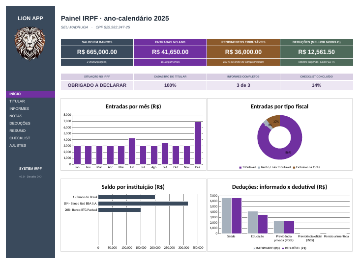
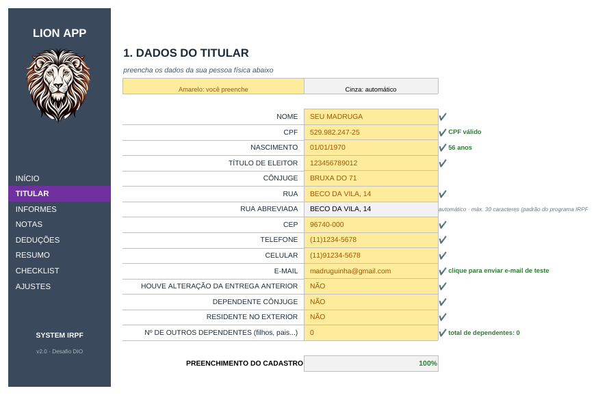
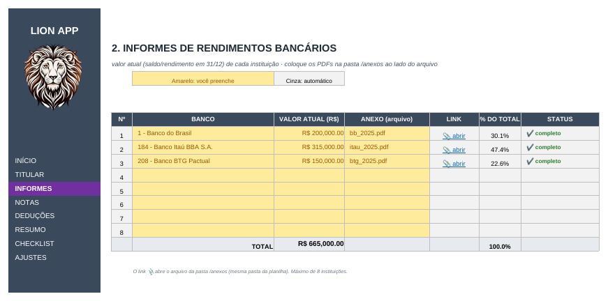
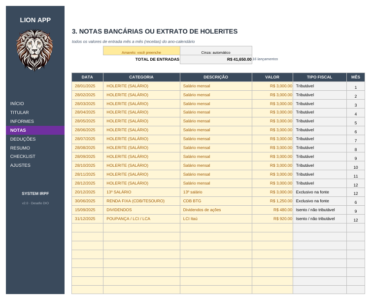
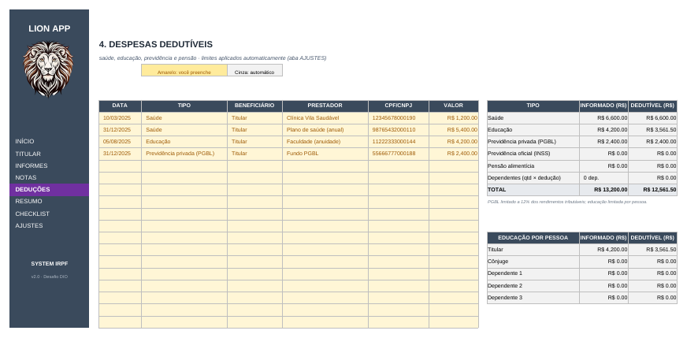
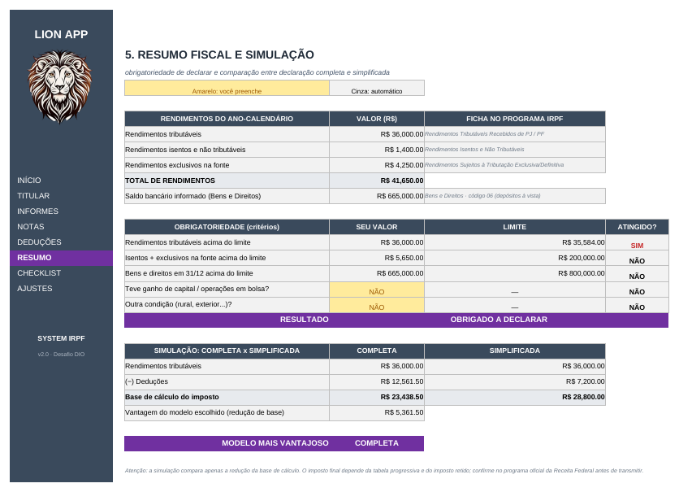
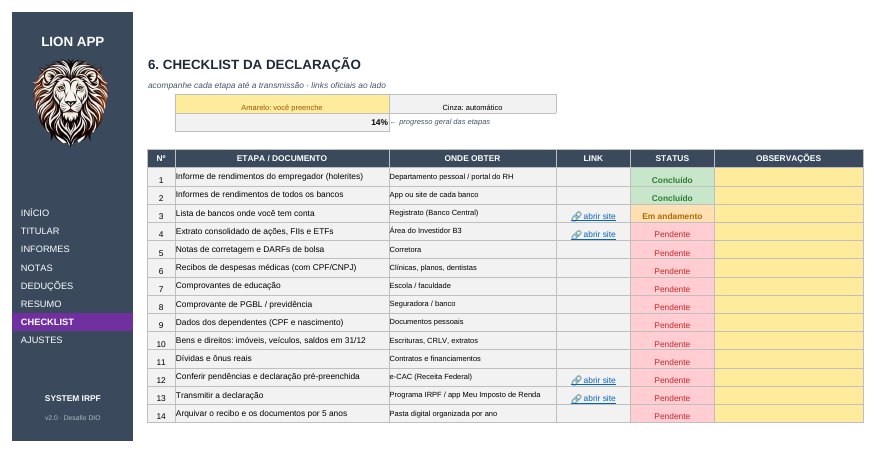

# 🦁 LION APP · Agregador de Dados para o Imposto de Renda (IRPF) em Excel

Ferramenta 100% Excel (sem macros) para **organizar, validar e reunir as informações essenciais da declaração de Imposto de Renda**: dados do titular, informes bancários, entradas do ano, despesas dedutíveis, checklist de documentos e uma simulação que indica se a declaração **completa** ou **simplificada** reduz mais a base de cálculo.

> Todos os dados do arquivo (Seu Madruga, CPF, bancos, valores) são **fictícios**, apenas para demonstração.

---

## ✨ O que o projeto entrega

| Aba | O que faz |
|---|---|
| **INÍCIO** | Dashboard com 4 indicadores, 4 faixas de status e 4 gráficos (entradas por mês, entradas por tipo fiscal, saldo por instituição, deduções informado x dedutível) + links rápidos oficiais |
| **TITULAR** | Cadastro do contribuinte com validação de CPF (dígito verificador), data, CEP, telefone, e-mail, título de eleitor e listas SIM/NÃO. Mostra % de preenchimento |
| **INFORMES** | Até 8 instituições escolhidas em lista suspensa (código - banco), valor atual, arquivo anexo com link clicável, % do total e status de cada linha |
| **NOTAS** | Até 200 lançamentos de entrada. A categoria define automaticamente o **tipo fiscal** (tributável, isento, exclusivo na fonte) e o mês |
| **DEDUÇÕES** | Despesas de saúde, educação, previdência e pensão com limites aplicados automaticamente (educação por pessoa, PGBL a 12%, dedução por dependente) |
| **RESUMO** | Rendimentos por tipo, **checagem de obrigatoriedade** e **simulação completa x simplificada** com recomendação |
| **CHECKLIST** | 14 etapas da declaração com status colorido e % de conclusão |
| **AJUSTES** | Todos os parâmetros legais em células próprias, com a fonte de cada valor |

Menu lateral com navegação por hiperlinks em todas as abas, mantendo a identidade visual do protótipo original (leão, barra escura e destaque roxo).

## 🖼️ Capturas de tela

| TITULAR | INFORMES |
|---|---|
|  |  |

| NOTAS | DEDUÇÕES |
|---|---|
|  |  |

| RESUMO | CHECKLIST |
|---|---|
|  |  |

## 🧠 Conceitos de Excel aplicados

- **Validação de dados**: listas suspensas ligadas a intervalos nomeados, números inteiros/decimais, datas dinâmicas (`DATE(p_ano,1,1)`), comprimento de texto e regras personalizadas (e-mail, extensão do anexo, CPF/CNPJ), todas com mensagem de erro em português.
- **Validação de CPF por fórmula**: `SUMPRODUCT` com constantes de matriz calcula os dois dígitos verificadores e rejeita sequências repetidas.
- **Fórmulas**: `SUMIFS`, `SUMIF`, `COUNTIF`, `INDEX/MATCH`, `IFERROR`, `SUMPRODUCT`, `TEXT`, `MIN/MAX`, `HYPERLINK`.
- **Intervalos nomeados** (`p_ano`, `r_trib`, `lst_bancos`...) para fórmulas legíveis.
- **Formatação condicional**: status ✔ / ⚠ / ✖, duplicidade de bancos, cores do checklist.
- **Tabelas do Excel** (`tblNotas`, `tblDeducoes`) com filtros.
- **Gráficos nativos** de colunas, barras e rosca.
- **Links rápidos**: Receita Federal, e-CAC, consulta de CPF, B3, Registrato (Banco Central) e Meu INSS.

## 🚀 Como usar

1. Baixe `LION_APP_IRPF.xlsx` e abra no Excel (2016 ou superior).
2. **Substitua os dados de exemplo**: células amarelas são de preenchimento, cinzas são cálculos automáticos.
3. Preencha as abas na ordem do menu (TITULAR → INFORMES → NOTAS → DEDUÇÕES).
4. Salve os comprovantes na pasta `anexos/`, ao lado da planilha. O link 📎 da aba INFORMES abre o arquivo pelo nome digitado.
5. Acompanhe o **dashboard**, a **obrigatoriedade** e o **modelo sugerido** no RESUMO.
6. Use o **CHECKLIST** até transmitir a declaração no programa oficial da Receita Federal.

## ⚖️ Parâmetros e fontes (ano-calendário 2025)

| Parâmetro | Valor | Fonte |
|---|---|---|
| Limite de rendimentos tributáveis | R$ 35.584,00 | Calculacentro, guia IR 2026 |
| Limite de isentos/exclusivos | R$ 200.000,00 | Calculacentro, guia IR 2026 |
| Dedução por dependente | R$ 2.275,08 | Qive, guia IRPF 2026 |
| Limite de educação por pessoa | R$ 3.561,50 | Qive, guia IRPF 2026 |
| Desconto simplificado | 20% (teto R$ 17.640,00) | Qive e Calculacentro |
| Bens e direitos / PGBL | R$ 800.000 / 12% | Regras da Receita (conferir no gov.br) |

Todos ficam na aba **AJUSTES** e podem ser atualizados a cada ano.

## ⚠️ Limitações

- A simulação compara a **redução da base de cálculo**, não calcula o imposto final (tabela progressiva e imposto retido).
- É uma ferramenta de **organização**, não substitui o programa da Receita nem orientação de contador.
- Confira sempre os limites no site oficial: <https://www.gov.br/receitafederal>.

## 🔮 Próximos passos

- Tabela progressiva e cálculo do imposto a pagar/restituir
- Ficha de bens e direitos (imóveis, veículos, ações)
- Importação de informes em CSV e comparação entre anos

## 📚 O que aprendi

Estruturar um projeto de planilha como um sistema: separar entradas, cálculos e visualização; proteger a qualidade dos dados com validações; e documentar premissas e fontes.

---
Feito com ☕ e Excel
